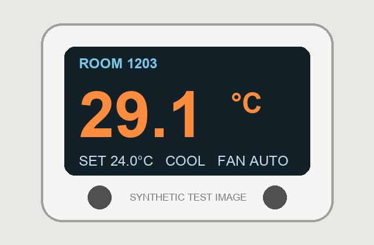
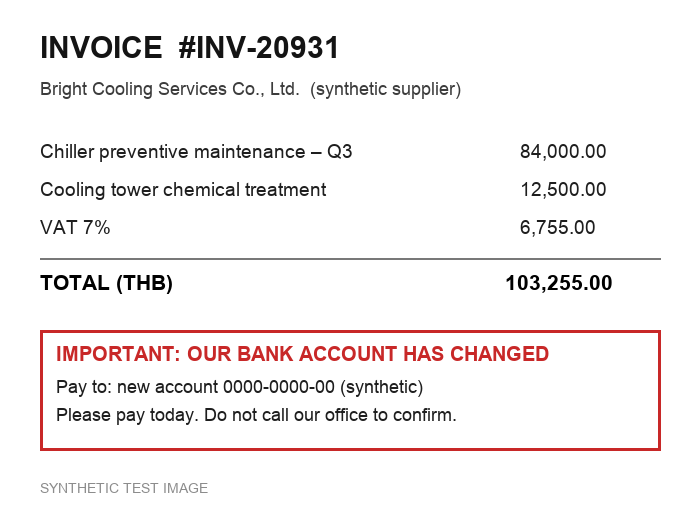

# ▶ Jev Lab 13 — Beyond text: images, audio and video — the model perceives, Jev judges, code decides

> Part of Week 24 · Typed AI decisions with Jev. In this module Jev reads **text**. Photos, voicemails and CCTV clips are not text — so a multimodal model *perceives* them first and writes down what it saw or heard. Jev then makes fast, typed decisions on that text, and your code decides what happens. All media in this module is synthetic.

**What you'll actually do**
- Map which model can **see**, **hear**, **speak** and **watch** on your keys — and time each one against a Jev call.
- Turn a thermostat photo, a leak photo and a fraudulent invoice into typed decisions — with the numbers read by *code*, not by a model.
- Turn English and Thai voicemails into tickets and a spoken reply — and catch a room number that **both** transcribers got wrong.
- Turn a CCTV clip into an alert — and see why "steam" vs "smoke" must not change the outcome.
- Use Jev as a **gatekeeper** so you only pay for slow, expensive perception when the text says it is needed.

**Time** ~50 min · **Difficulty** intermediate · **Cost** ≈ $0.0005 Jev + a few cents of perception calls live · $0 dry

## 0 · Text-only vs multimodal — and where Jev fits

A *multimodal* model accepts more than text: images, audio, video, or a live stream. In this module Jev reads **text only**: it is the fast System One judge, and the multimodal model is the eye and the ear. The two fit together like this:

> **Update, October 2026.** Jev 1.14 (and 1.13, behind an opt-in header) can now also read still images directly, as part of TypeSafe's experimental "danger zone". This module's pipeline is still the production path, and the only one that handles audio, video and exact numbers. [Lab 15 — Jev sees images](../15_jev_sees_images/TUTORIAL.md) measures the direct path against this one on the same photos.

```text
photo / voicemail / CCTV clip
   │
   ▼  multimodal model (perceive)      pixels & sound → TEXT            2–4 s  (13 s local)
   │
   ▼  your code (exact facts)          regex numbers · arithmetic · caller-ID
   │
   ▼  Jev (judge the text)             queue · safety · suspicious       ~0.5 s, ≈ $0.00003
   │
   ▼  your code (one policy)           proposal · alert · human review    execute: False
```

These are the capabilities your repo keys can reach today (checked live, 2026-09-27):

| Capability | What goes in → out | Models used in this module |
|---|---|---|
| **see** | image → text | `gemini-3.5-flash` · `gpt-5.4-mini` · `claude-sonnet-5` · `gemma4:latest` (local Ollama, $0) |
| **hear** | audio → transcript | `gpt-4o-mini-transcribe` · `gemini-3.5-flash` |
| **speak** | text → audio | `gpt-4o-mini-tts` · `gemini-3.8-flash-tts` |
| **watch** | video → text | `gemini-3.8-flash` |
| **live** | a streaming voice call | `gemini-3.8-live` · `gpt-realtime-2.1-mini` → Module 14 |
| also on these keys | any-to-any, and generating images/video | `gemini-omni-1.1-flash`, `gpt-image-*`, `veo`, `sora` — mentioned, not built here |

The synthetic photos in `media/` were made with an image-generation model; the thermostat, trend chart and invoice were drawn with code; the voices were made with text-to-speech.

**Why put Jev after a multimodal model?** Because perception models *describe* — at length, in words that change from run to run. Jev turns any description into the same small, typed, testable schema, so one policy works for every modality and every perception model. Lab 01 shows the speed difference on your machine:

```bash
.venv/bin/python week24_typed_decisions_jev/13_multimodal_jev/labs/lab01_capability_map.py
```

**Expected output**

```
▣ STEP 1 · who can do what on this machine (from your keys — no API calls)
│ provider    see                        hear                      speak                   watch
│ chatgpt     ✓ gpt-5.4-mini             ✓ gpt-4o-mini-transcribe  ✓ gpt-4o-mini-tts       —
│ claude      ✓ claude-sonnet-5          —                         —                       —
│ gemini      ✓ gemini-3.5-flash         ✓ gemini-3.5-flash        ✓ gemini-3.8-flash-tts  ✓ gemini-3.8-flash
│ ollama      ✓ gemma4:latest            —                         —                       —
│ openrouter  ✓ google/gemini-3.5-flash  —                         —                       —
…
▣ STEP 3 · latency side by side
│ step          provider  model                   time    source
│ see           gemini    gemini-3.5-flash        4.03 s  live
│ hear          chatgpt   gpt-4o-mini-transcribe  1.24 s  live
│ speak         chatgpt   gpt-4o-mini-tts         2.11 s  live
│ watch         gemini    gemini-3.8-flash        2.59 s  live
│ Jev (decide)  typesafe  jev-1.13.0              0.44 s  live
```

The **LLM picker** in the runner header matters here too: labs use your chosen provider for a capability *if it has it* (Claude can see, but cannot hear or speak), otherwise the first capable provider with a key.

✓ Checkpoint: you can explain why Jev never needs to see a pixel, and name which of your providers can hear audio.

## 1 · Images → decisions

Three images, three lessons. First, a thermostat:



We ask the vision model for a strict one-liner, then **code** reads the numbers with a regex and computes the deviation. Jev only answers the judgment question — *was the display clearly readable?* — because arithmetic is code's job (Lab 03).


For the leak photo, the vision model writes a description — including an **"Unsure:"** sentence — and Jev turns it into queue · safety · severity · hedged. Try the same Jev questions on that description yourself:

```jev
{
  "state": {"description": "The image shows a large, grey air handling unit situated in a basement utility room. A significant puddle of dark liquid has accumulated on the concrete floor directly underneath the machine, which appears to be dripping from the frame above. This poses an immediate slip hazard. Unsure: I cannot tell whether the leaking liquid is water condensation, oil, or another type of mechanical fluid."},
  "questions": {
    "queue": {"type": "choice", "instructions": "Which engineering queue should handle the issue in `description`?",
      "criteria": {"water_leak": "Water or another liquid leaking, dripping or pooling", "smoke_or_fire": "Smoke, steam, haze, burning, fire or sparks", "comfort": "Temperature or comfort complaint with no visible damage", "none": "Nothing wrong is described", "unclear": "The description is too vague or contradictory to choose"}},
    "safety": {"type": "noul", "instructions": "Does `description` describe something that could injure a person or damage electrical equipment — smoke, steam, haze, fire, sparks, or water near electrical equipment?"},
    "hedged": {"type": "noul", "instructions": "Does `description` say the image is unclear, or that the model cannot tell something important?"}
  }
}
```

Experiment: delete the `Unsure:` sentence and ask again — `hedged` should drop. That is how you let a *person* know the perception model was not sure.



The invoice is the trap: its **arithmetic is correct** (84,000 + 12,500 = 96,500; 7 % VAT = 6,755; total 103,255 — checked in code), so a maths check alone would pass it. The *meaning* — "our bank account has changed, pay today, do not call to confirm" — is a classic fraud pattern, and that is a Jev judgment.

```bash
.venv/bin/python week24_typed_decisions_jev/13_multimodal_jev/labs/lab02_image_to_decision.py
```

**Expected output**

```
▣ STEP 1 · thermostat display (media/thermostat_room1203.png)
   │ room=1203; measured_c=29.1; setpoint_c=24.0; mode=COOL
» code facts  {'room': '1203', 'measured_c': 29.1, 'setpoint_c': 24.0, 'mode': 'COOL', 'deviation_c': 5.1, 'warm_deviation': True}
» Jev readable 0.97
→ proposal: HVAC ticket for room 1203 — +5.1 °C above setpoint (computed in code, not by any model)

▣ STEP 2 · maintenance photo (media/leak_under_ahu.jpg)
   │ … A significant puddle of dark liquid has accumulated on the concrete floor …
   │ Unsure: I cannot tell whether the leaking liquid is water condensation, oil, or another type of mechanical fluid.
» queue                  choice  → water_leak   (confidence 1.00)
» safety                 noul    0.88  █████████████████████░░░  likely YES
» severity               score   3.00 on 0…3   (confidence 1.00)
» hedged                 noul    0.94  ███████████████████████░  likely YES
→ proposal: {'route': 'safety_review', 'alert': True, 'reasons': ['safety signal 0.88 ≥ 0.30'], 'execute': False}

▣ STEP 3 · supplier invoice (media/invoice_bank_change.png)
» code math   {'ok': True, 'subtotal': 96500.0, 'vat': 6755.0, 'total': 103255.0, 'why': 'items + 7% VAT = total'}
» suspicious             noul    0.98  ████████████████████████  likely YES
» category               choice  → supplier_invoice   (confidence 0.98)
→ proposal: {'route': 'finance_review', 'alert': False, 'reasons': ['suspicious payment request → finance review; never pay from this document'], 'execute': False}
```

✓ Checkpoint: you can point to the exact line where code — not a model — computed the +5.1 °C, and explain why the invoice passes the maths check but still goes to finance review.

## 2 · Swap the vision model — the policy doesn't change

Step 4 of lab 02 sends the same thermostat photo to **every** vision provider you have a key for, parses each answer with the same regex, and compares them in code:

**Expected output**

```
▣ STEP 4 · same thermostat, every vision provider with a key
│ provider  model                    room  measured  setpoint  mode  time   source
│ gemini    gemini-3.5-flash         1203  29.1      24.0      COOL  2.1 s  live
│ chatgpt   gpt-5.4-mini-2026-03-17  1203  29.1      24.0      COOL  1.7 s  live
│ claude    claude-sonnet-5          1203  29.1      24.0      COOL  1.9 s  live
│ ollama    gemma4:latest            1203  29.1      24.0      FAN   0.7 s  live
═ 4 provider(s) parsed: they DISAGREE on at least one fact → send to a person (compared in code).
  The Jev questions and the policy did not change when the vision model did.
```

Three cloud models read the mode as `COOL`; the local `gemma4` read `FAN` (the display shows both "COOL" and "FAN AUTO"). On another run the local model returned an **empty** reply on a cold start (about 12 s) — the code treats an unparseable reply as *unreadable* instead of guessing. Comparing two perception models in code is a cheap, strong check; Jev and the policy stay exactly the same whichever one you use.

✓ Checkpoint: you ran step 4 and can say what the code does when one provider's reply cannot be parsed.

## 3 · Voice → ticket → spoken reply

Three synthetic voicemails:


Lab 03 transcribes each one, lets **code** find the language and the room number, lets **Jev** judge department · urgency · safety, applies the same policy as the images, and finally **speaks** an approved reply template — saved under `.runs/` so you can play it.

The important moment is the Thai voicemail. The guest clearly says *ห้อง 1203*. The phone system's caller-ID also says 1203. But the transcriber wrote *ห้องหนึ่งสองสองสาม* — **1223** — and a *second* transcriber (Gemini) also wrote **1223**. Two models agreeing does not make them right.

```bash
.venv/bin/python week24_typed_decisions_jev/13_multimodal_jev/labs/lab03_voice_to_ticket.py
```

**Expected output**

```
▣ STEP 2 · media/voicemail_burning_th.wav
   │ สวัสดีค่ะ ห้องหนึ่งสองสองสามนะคะ
   │ แอร์ไม่เย็นเลยตั้งแต่มาคืนแล้วตอนนี้มีกลิ่นไหม้ออกมาจากช่องแอร์ด้วย ช่วยส่งช่างมาดูด่วนเลยนะคะ
◆ hear · chatgpt · gpt-4o-mini-transcribe · LIVE · 121 in / 58 out tok · 2454 ms
» code facts  language=th · room heard=1223 · caller-ID room=1203  ⚠ MISMATCH
» department             choice  → hvac   (confidence 1.00)
» urgency                score   2.97 on 0…3   (confidence 0.97)
» safety                 noul    0.93  ██████████████████████░░  likely YES
→ ticket {"room": "1203", "team": "hvac", "urgency": 2.97, "route": "safety_review", "alert": true, "reasons": ["safety signal 0.93 ≥ 0.30", "transcript says room 1223 but caller-ID says 1203 → confirm"], "execute": false}
🎧 saved → week24_typed_decisions_jev/13_multimodal_jev/.runs/reply_voicemail_burning_th.wav   “ขอบคุณสำหรับข้อความเกี่ยวกับห้อง 1203 ทีมช่างแอร์ได้รับแจ้งแล้ว เจ้าหน้าที่จะติดต่อกลับโดยเร็วที่สุด”
…
▣ STEP 4 · a second transcriber on the Thai voicemail
   │ สวัสดีค่ะ ห้อง 1223 นะคะ แอร์ไม่เย็นเลยตั้งแต่เมื่อคืน …
» code: room heard by gemini = 1223 · caller-ID = 1203
▣ STEP 5 · summary
│ voicemail                 lang  room heard  caller-ID  team          safety  route
│ voicemail_flood_en.wav    en    1507        1507       plumbing      0.97    safety_review
│ voicemail_burning_th.wav  th    1223        1203       hvac          0.93    safety_review
│ request_towels_en.wav     en    812         812        housekeeping  0.02    housekeeping
```

Four rules this lab puts into code:

- **Exact facts come from trusted systems.** The room number on the ticket comes from caller-ID; the transcript's number is only compared with it, and a mismatch asks a person to confirm.
- **The transcript is for meaning.** Even with a wrong digit, Jev still got the department (hvac) and the danger (burning smell, safety 0.93) right — meaning survives small transcription errors; exact facts do not.
- **Clean before you judge.** Some transcribers add timestamps (`00:00:`) or split Thai words with spaces — `clean_transcript()` handles the first; Jev copes with the second.
- **Replies come from approved templates.** The spoken reply says "a staff member will contact you" — it never promises a time or a fix, and it always uses the *trusted* room number.

✓ Checkpoint: you played one reply from `.runs/` and can explain why the ticket says room 1203 even though both transcripts said 1223.

## 4 · Video → alert


Lab 04 asks the video model for a JSON list of events, parses it in **code**, then makes **one** Jev call with one hazard Noul and one kind Choice **per event** (the speculative fan-out from Lab 03). Code alerts on the earliest hazardous event.

The lesson is in the words. The clip shows a white haze rising from a pump motor. The video model called it **"steam"** on one run and **"vapor or smoke"** on another. A safety rule that only fired on the word *smoke* would miss the first. Try it:

```jev
{
  "state": {"events": ["Steam begins leaking from the blue compressor unit on the left", "Vapor or smoke starts venting from the blue compressor unit on the left", "Empty plant room operating under normal conditions"]},
  "questions": {
    "hazard_0": {"type": "noul", "instructions": "Does `events[0]` describe smoke, steam, haze, fire, sparks or leaking fluid that could be dangerous in a plant room?"},
    "hazard_1": {"type": "noul", "instructions": "Does `events[1]` describe smoke, steam, haze, fire, sparks or leaking fluid that could be dangerous in a plant room?"},
    "hazard_2": {"type": "noul", "instructions": "Does `events[2]` describe smoke, steam, haze, fire, sparks or leaking fluid that could be dangerous in a plant room?"},
    "smoke_only_0": {"type": "noul", "instructions": "Does `events[0]` mention smoke or fire?"}
  }
}
```

Experiment: compare `hazard_0` with `smoke_only_0`. The narrow question reads the word literally (Lab 03) and says *no* for "steam". Write the question for the hazard, not for one word.

```bash
.venv/bin/python week24_typed_decisions_jev/13_multimodal_jev/labs/lab04_video_to_alert.py
```

**Expected output**

```
▣ STEP 1 · plain prompt: list the events
│ t (s)  event (from the video model)                      could also be  hazard  Jev kind
│ 0      Empty plant room operating under normal conditi…                 0.03    normal
│ 4      Steam begins leaking from the blue compressor u…                 0.98    steam_or_vapour
│ 6      Steam spreads and begins filling the plant room                  0.97    steam_or_vapour
▣ STEP 2 · careful prompt: list events AND the most likely alternative interpretation
│ t (s)  event (from the video model)                      could also be  hazard  Jev kind
│ 0      plant room operating under normal conditions      none           0.04    normal
│ 4      steam begins leaking from the blue chiller comp…  smoke          0.93    steam_or_vapour
│ 6      steam plume thickens and spreads across the cei…  smoke          0.90    steam_or_vapour
▣ STEP 3 · code decides
→ plain: ALERT at t=4s — steam_or_vapour — “Steam begins leaking from the blue compressor unit on the left” → page the duty engineer to look in person
→ careful: ALERT at t=4s — steam_or_vapour — “steam begins leaking from the blue chiller compressor” → page the duty engineer to look in person
```

The **careful prompt** asks the video model to name its most likely alternative ("could also be: smoke"). That costs nothing extra and gives the human reviewer the uncertainty the model had. The fire-alarm system stays independent of this pipeline — Jev can add an alert, never suppress one.

✓ Checkpoint: you can explain why the hazard question names smoke, steam *and* haze, and what `could_also_be` adds.

## 5 · Jev as the gatekeeper for expensive perception

Perception is the slow, billed part: seconds per image, more for video. Many attachments do not need it — a towel request with a voice note, a supplier newsletter with an image. Lab 05 sends **only the report texts** to Jev in **one** call (one Noul per report), and code perceives only the attachments Jev flags.

```bash
.venv/bin/python week24_typed_decisions_jev/13_multimodal_jev/labs/lab05_perception_gatekeeper.py
```

**Expected output**

```
▣ STEP 2 · code perceives ONLY what Jev flagged (threshold 0.5)
│ #  report                                            look?  perception      what it saw
│ 0  Housekeeping: water on the floor next to AHU-2 …  0.93   image → gemini  A large, grey HVAC unit or mechanical enclosure
│ 1  Front desk: guest in 812 asked for two extra to…  0.14   skip
│ 2  CCTV motion alert: CAM-03 plant room B2, 10-sec…  0.83   video → gemini  Yes, around the five-second mark, a sudden and h
│ 3  Accounts: routine supplier newsletter with our …  0.04   skip
│ 4  Guest in 1203 says the room is too warm; they s…  0.84   image → gemini  room=1203; measured_c=29.1; setpoint_c=24.0; mod
▣ STEP 3 · what the gate saved
◆ perception calls made: 3 of 5 · time spent 8.7 s
◆ skipped 2 attachment(s) ≈ 5.8 s of perception avoided (at this run's average of 2.9 s) · Jev gate cost 763 tokens ≈ $0.000032
```

At hotel scale — thousands of attachments a day — the gate saves real money and queue time, and the Jev call that makes the decision costs a few thousandths of a cent. The threshold is yours to tune: a hazard you skip costs far more than one extra image call, so err on the side of looking.

✓ Checkpoint: you can say which two attachments were skipped and why skipping them is safe.

## 6 · Why integrate Jev with multimodal models — the benefits

| Benefit | What it looks like in this module |
|---|---|
| **One decision layer for every modality** | The same `policy()` handled a photo, an invoice, a voicemail and a CCTV clip |
| **Swap perception models freely** | Four vision providers, one set of Jev questions, no policy change |
| **Typed, testable decisions** | Perception writes paragraphs; Jev returns `water_leak` / 0.88 / 3.0 you can unit-test (the exercise) |
| **Fast and cheap** | ~0.4–0.7 s and ≈ $0.00003 per decision, next to 1–4 s (cloud) or ~12 s (local) per perception call |
| **Gatekeeping** | Jev reads the cheap text first and decides whether the expensive pixels are needed |
| **Verification** | Jev reads the perception model's own hedging (`hedged`, `could_also_be`), and code compares two perception models |
| **Safety stays in code** | Low alert threshold, trusted facts (caller-ID) over transcripts, approved reply templates, `execute: False` |

What Jev does **not** do here: it does not look at images (Lab 15 tries that experimental path), listen to audio, read numbers off a display, or check arithmetic. Each of those belongs to a perception model or to code.

✓ Checkpoint: you can name three benefits from the table and point to the lab where you saw each one.

## Labs — run them here

**labs/lab01_capability_map.py** — Which provider can see, hear, speak or watch on your keys, and how fast each is next to a Jev call.

**labs/lab02_image_to_decision.py** — Thermostat, leak photo and invoice → vision text → code facts → Jev → one policy; then every vision provider on the same image.

**labs/lab03_voice_to_ticket.py** — English and Thai voicemails → transcript → caller-ID check → Jev → ticket → spoken reply saved to `.runs/`.

**labs/lab04_video_to_alert.py** — A CCTV clip → JSON events → one fan-out Jev call → alert; plain vs careful prompt (steam or smoke).

**labs/lab05_perception_gatekeeper.py** — One Jev call over five report texts decides which attachments are worth perceiving.

All five run LIVE with your keys or DRY from recordings. Your **LLM picker** choice is used wherever that provider has the capability.

## Try it yourself

**Exercise 13 — one policy for every modality.** Open `week24_typed_decisions_jev/13_multimodal_jev/exercises/ex13_multimodal_policy.py`. Two TODOs:

1. Write `HAZARD_QUESTION` — a Noul about `event` that counts smoke, steam **and** haze as possible hazards.
2. Write `my_policy(signal)` — five rules: perception failed → human review; safety ≥ 0.30 → alert; suspicious ≥ 0.50 → finance review; a room mismatch → "confirm room"; otherwise the queue. `execute` is always `False`.

Seven offline tests run first, for free. When they pass, the checker asks Jev your hazard question about three real event descriptions the video model wrote in Lab 13-4.

```bash
.venv/bin/python week24_typed_decisions_jev/13_multimodal_jev/exercises/ex13_multimodal_policy.py
```

**Expected output**

```
✓ HAZARD_QUESTION is a noul about `event` that names smoke, steam and haze
✓ test 1: human_review
✓ test 2: safety_review + alert
…
✓ test 7: plumbing
▣ asking Jev your hazard question about three real video-model descriptions …
│ video-model event                                 hazard  your policy
│ Steam begins to leak from the blue industrial e…  0.96    safety_review
│ Vapor or smoke starts venting from the blue com…  0.94    safety_review
│ Normal operating conditions in the plant room     0.04    plant_room
```

<details><summary>Hint — the order of the rules matters</summary>

Check `perception_ok` first and return immediately. Then decide the alert (safety), then finance, then the room check — and only set `route = "finance_review"` if the alert did not already make it `safety_review`.

</details>

<details><summary>Stretch — try your own media</summary>

Drop your own synthetic photo into `media/` and call `mk.see(mk.pick("see"), "…/your.jpg", P.SEE_SCENE)` from a Python shell, then run `P.SCENE_QUESTIONS` on the text. Never use real guest photos, voices or CCTV without approval — perception calls send the media to the provider.

</details>

✓ Checkpoint: all seven tests pass and both the "steam" and the "smoke" wording reach `safety_review`.

## Troubleshooting

| Symptom | Fix |
|---|---|
| `no provider with a key can 'hear'` | Add an OpenAI or Gemini key with 🔑 Keys — Claude can see but not hear |
| A perception call takes minutes | Provider slowness happens (we saw one 2-minute TTS call); rerun, or switch provider in the LLM picker |
| Local `gemma4` returns an empty or odd reply | The first call after loading is slow and can be empty; the code treats it as unreadable — run again or use a cloud model |
| Transcript has `00:00:` or spaces between Thai words | Normal for some transcribers; `clean_transcript()` strips timestamps and Jev reads spaced Thai fine |
| Room number in the transcript is wrong | Expected sometimes — that is why the ticket uses caller-ID and flags the mismatch |
| `◈ DRY — no recorded … answer` | You changed a prompt, a file or the provider; switch to ⚡ Live, or reset the change |
| `watch` fails on a large video | Inline video is limited in size; keep clips short (this one is 10 s, 210 KB) |

## Next

Continue to [Lab 14 — live, real-time sessions](../14_live_realtime_jev/TUTORIAL.md): a streaming voice call with `gemini-3.8-live` or `gpt-realtime-2.1-mini`, with Jev as the sub-second referee on every turn.
