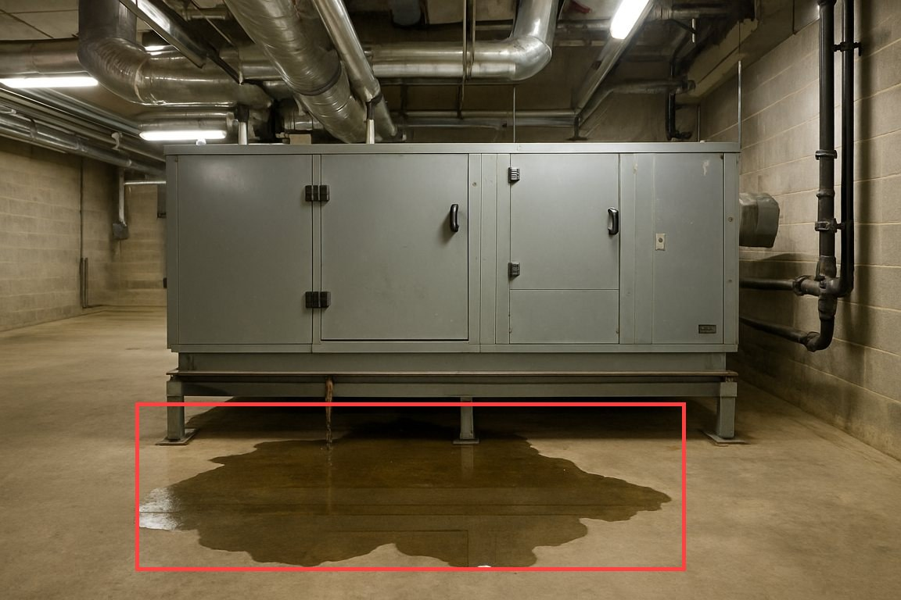

# ▶ Jev Lab 15 — Jev sees images: photos, Box and long context in Jev 1.14

> Part of Week 24 · Typed AI decisions with Jev. On 2026-10-14 TypeSafe released **Jev 1.14.0** together with three "danger zone" features for builders who want to experiment: **images** inside any request, a new **`box`** question type that says *where* something is, and **long context** (262k tokens). In Module 13 a vision LLM had to describe a photo before Jev could judge it. Here Jev looks at the photo itself, and you measure when that is better. All media is synthetic.

**What you'll actually do**
- Send a photo straight to Jev, and see the HTTP 400 you get without the opt-in header.
- Put images in the three places text can go: `state`, `instructions` and `criteria`. Then compare two CCTV frames over time.
- Find a puddle with a **Box**, crop it, and stop a box drawn around something that isn't there.
- Race the direct path against Module 13's vision-LLM pipeline on the same photos.
- Compare Jev 1.13 with 1.14 on images, Box and Thai, and push a 47k-token log through long context.

**Time** ~40 min · **Difficulty** intermediate · **Cost** ≈ $0.004 live (images ≈ $0.0001 each, one long-context call ≈ $0.002) · $0 dry

## 0 · What Jev 1.14 adds, and what "danger zone" means

TypeSafe's release post ("Jev: For the builders AND dreamers", 2026-10-14) ships one stable improvement and three experiments:

| Feature | How you turn it on | Works on | Status |
|---|---|---|---|
| **jev-1.14.0** with small gains everywhere, largest in multilingual | `"model": "jev-1.14.0"` or the `jev-preview` alias | 1.14 | official release; `jev-latest` follows "in a week" |
| **Images** in `state`, `instructions` or `criteria` | header `TypeSafe-Danger-Zone-Images: true` + an `assets` map | 1.13 **and** 1.14 ("multimodal all along") | dreamer-ready, not production |
| **`box`** question that returns one bounding box | same images header | **1.14 only** | dreamer-ready |
| **Long context** (262k instead of 64k per request / 32k per question) | header `TypeSafe-Danger-Zone-Long-Context: true` | 1.13 and 1.14 | slower and less accurate, same price |

"Danger zone" is TypeSafe's own wording. These features are here to stay and will keep improving. But TypeSafe says they are still too *jagged* (uneven, sometimes surprising) for it to vouch for them in production. The course keeps the rule it has used since Module 01: **Jev judges and code decides**, with a person in the loop for anything new.

```text
photo ── image() ──► {state: {"photo": "img-…"},  assets: {"img-…": {jpg, base64}},  questions}
                                │  header TypeSafe-Danger-Zone-Images: true
                                ▼
                     Jev 1.14  →  choice · noul · score · box      ~1 s · ~2.7k tokens · ≈ $0.0001
                                ▼
                     your code →  gate · crop · policy · execute: False
```

A note on versions: on 2026-10-17 `jev-preview` pointed at `jev-1.14.0` and `jev-latest` still pointed at `jev-1.13.0`. The course pins **`jev-1.13.0`** as its default so that DRY recordings replay exactly. Module 15 pins **`jev-1.14.0`** because Box needs it. The runner's model picker now offers both.

✓ Checkpoint: you can name the two headers, say which feature needs 1.14, and explain why the course still pins a version instead of using an alias.

## 1 · Your first image call

An image is listed **once** in a top-level `assets` map. Its key is a *reference string*, and you write that string wherever the image belongs. `jevkit.image()` prepares the file the way the docs ask: it rotates the pixels upright (the API strips EXIF and never applies its orientation), shrinks the longest side to 1568 px or less, pads anything under 280 px, and saves standard JPEG. It also makes the reference a content hash (`img-` + 16 hex characters), so the same photo always gets the same reference. That is what lets DRY mode replay image requests.

```bash
.venv/bin/python week24_typed_decisions_jev/15_jev_sees_images/labs/lab01_first_image_call.py
```

**Expected output**

```
▣ STEP 1 · prepare media/leak_under_ahu.jpg
» file: 1152×768 px · 123 KB
» reference: img-bdb430c290c344ad   (sha256 of the file → the same photo always gets the same reference)
…
▣ STEP 3 · send it WITHOUT the danger-zone header
✕ HTTP 400 … "Images are experimental. Send the header TypeSafe-Danger-Zone-Images: true to use them."
▣ STEP 4 · send it WITH the header (jevkit adds it when assets are present)
» leak                   noul    0.98  ████████████████████████  likely YES
» queue                  choice  → water_leak   (confidence 1.00)
◆ jev-1.14.0 · LIVE · 2784 input tok · $0.000117 · 1083 ms
```

Images are billed as ordinary **input tokens**. There is no separate image price. One 1152×768 photo is about 2.6k tokens, roughly 15× a short text call, and still about $0.0001. The limits to remember are: PNG or JPEG only, each side 280–1568 px, 16 MiB per file, and 32 MiB per request. If **any** image breaks a limit, the whole request fails. There are no partial answers.

✓ Checkpoint: you saw the 400 without the header, and you can explain why a content-hash reference is safer than a short name like `cat`.

## 2 · An image can go anywhere text can go

| Where | What it means | Lab 15-2 example |
|---|---|---|
| `state` | evidence that every question is asked about | the leak photo, next to a text field `location` |
| `instructions` | a picture that belongs to **one** question | "is `photo` the same room as this reference picture: img-…?" |
| `criteria` | options defined **by example** instead of by words | `normal` / `haze` / `water` each shown with a picture |
| a list in `state` | a short history, oldest first | two CCTV frames: "did haze appear between them?" |

```bash
.venv/bin/python week24_typed_decisions_jev/15_jev_sees_images/labs/lab02_where_images_go.py
```

**Expected output**

```
▣ STEP 2 · INSTRUCTIONS — compare a live CCTV frame against a known reference photo
» same_room              noul    0.53  █████████████░░░░░░░░░░░  uncertain
» differs_from_normal    noul    0.98  ████████████████████████  likely YES
◆ jev-1.14.0 · LIVE · 6702 input tok · $0.000281 · 804 ms
▣ STEP 3 · CRITERIA — options defined by example pictures (and one by words)
   photo = media/cctv_t1s.jpg   → normal (confidence 0.99)
   photo = media/cctv_t7s.jpg   → haze   (confidence 1.00)
▣ STEP 4 · FRAMES — a short history, oldest first: what changed?
» haze_appeared          noul    0.99  ████████████████████████  likely YES
» haze_before            noul    0.02  ░░░░░░░░░░░░░░░░░░░░░░░░  likely NO
```

Look at `same_room = 0.53`. The CCTV frame and the reference photo show the same room, but the frame has a caption bar, a different crop and haze. Jev was unsure, and it *said so*. This is the jaggedness TypeSafe warns about. Simple, decomposed questions (`differs_from_normal`) did much better than a holistic one. Two more rules from the docs that the token counts confirm: **every use of a reference adds the image again** (6.7k tokens with one reference picture, 9.1k with three examples), and **option names are object keys**, so they are never replaced by images. Your code still receives `normal` / `haze`.

✓ Checkpoint: you can explain why `same_room` was uncertain while `differs_from_normal` was not, and where to put an image that three questions all need.

## 3 · Box: where is it?

A `box` question returns the smallest rectangle around one target, as four edges that are fractions of the image (`top`, `bottom`, `left`, `right`, each 0–1), plus a `confidence`. Multiply by the pixel size to crop. Because the answer is a fraction, the same box works at any resolution.

```bash
.venv/bin/python week24_typed_decisions_jev/15_jev_sees_images/labs/lab03_box_and_crop.py
```

**Expected output**

```
▣ STEP 1 · media/leak_under_ahu.jpg — where is the puddle?
» puddle_visible         noul    0.97  ███████████████████████░  likely YES
» puddle                 box     top 0.67 · bottom 0.95 · left 0.15 · right 0.76   (17% of the image, confidence 0.69)
→ gate 0.97 · box confidence 0.69
» saved .runs/puddle_crop.jpg and .runs/puddle_box.jpg
▣ STEP 2 · ask for something that is not in the photo
» extinguisher_visible   noul    0.09  ██░░░░░░░░░░░░░░░░░░░░░░  likely NO
» extinguisher           box     top 0.02 · bottom 0.07 · left 0.64 · right 0.69   (0% of the image, confidence 0.34)
→ gate 0.09 < 0.8 → target probably absent, ignore the box
▣ STEP 4 · media/thermostat_room1203.png — find the reading, then ask about it
» band                   choice  → above_28   (confidence 1.00)
» above_setpoint         noul    0.97  ███████████████████████░  likely YES
```



The three habits this lab builds:

1. **A Box answer is always a box.** There is no "not found". Ask a Noul *in the same request* ("Is there a … in `photo`?"), and let code ignore the box when the Noul is low. Step 2 shows a rectangle drawn around nothing at 0.34 confidence.
2. **Confidence is a separate axis.** Below your threshold, pad the box (`V.pad`, 5 % on every side) or ask again on a larger crop. The docs give no recommended threshold, so tune it on your own images. The 0.80 / 0.60 in the lab are examples.
3. **Check a crop with edge questions.** Ask one Noul per edge ("does it continue past the left edge?"). In TypeSafe's test this caught 30 of 36 cut-offs, against 26 for a single "is all of it inside?". In our run the left edge scored 0.76 even though the box looks fine in the picture. Edge questions are a *signal* for a person, not proof.

Step 4 draws the line that Module 13 drew: Jev can say the thermostat is **above 28 °C** and **more than 3 °C above setpoint**, and Box can find the number. But Jev returns no text, so it can never tell you "29.1". Exact values still come from a vision LLM or OCR, and are checked by code.

✓ Checkpoint: you opened `.runs/puddle_box.jpg`, and you can explain why the extinguisher box was ignored even though Jev returned four valid edges.

## 4 · Direct or pipeline? Measure it

Lab 15-4 sends the same three photos down both paths with Module 13's questions unchanged:

- **pipeline**: `gemini-3.5-flash` describes the photo → Jev 1.13 judges `description`
- **direct**: Jev 1.14 judges `photo`

```bash
.venv/bin/python week24_typed_decisions_jev/15_jev_sees_images/labs/lab04_direct_vs_pipeline.py
```

**Expected output**

```
│ photo                 pipeline (text)              direct (image)               agree  pipe time  direct time
│ leak_under_ahu.jpg    water_leak · safety 0.93     water_leak · safety 0.96     ✓      4.2 s      1.1 s
│ plantroom_smoke.jpg   smoke_or_fire · safety 0.97  smoke_or_fire · safety 0.91  ✓      3.7 s      0.7 s
│ plantroom_normal.jpg  none · safety 0.47           none · safety 0.05           ✓      4.1 s      0.8 s
» 3/3 photos: same queue and same side of 0.5 on safety
```

On these photos the direct path was about 4× faster, used one bill instead of two, and was more decisive on the normal room. The pipeline's description of that room still made `safety` hover at 0.47. Three photos are a demo, not an evaluation. Run your own photos before you switch anything. Use this table to choose:

| Situation | Pick |
|---|---|
| you need an exact number or text (29.1 °C, an invoice total) | **pipeline**: Jev writes nothing |
| you need a human-readable trail ("what did the model see?") | **pipeline**: the description *is* the log |
| audio or video | **pipeline**: Jev takes still PNG/JPEG only (export frames, as in Lab 15-2) |
| a fast typed judgment on a photo, one call, one bill | **direct** |
| compare against a known picture, or define options by example | **direct**: text can't carry that |
| production today | pipeline, or direct behind a human gate. Images are "dreamer-ready" |

✓ Checkpoint: you can name one AltoTech workload where you would keep the pipeline and one where the direct path is worth a pilot.

## 5 · 1.13 vs 1.14, Thai, and long context

```bash
.venv/bin/python week24_typed_decisions_jev/15_jev_sees_images/labs/lab05_versions_and_long_context.py
```

**Expected output**

```
│ model       leak noul  input tok  Box question
│ jev-1.13.0  1.00       2652       ✕ HTTP 400 "Invalid request."
│ jev-1.14.0  0.98       2652       ✓ conf 0.71
…
│ ไม่ต้องส่งช่างมาแล้วนะคะ แอร์ก  no_action     ✓ no_action 0.70     ✓ no_action 0.86
» correct: jev-1.13.0 6/6 · jev-1.14.0 6/6 — six messages prove nothing; they show you HOW to check.
▣ STEP 4 · a 47k-token BMS log with one alarm buried in it
✕ without header: HTTP 400 … {"detail":{"error_type":"max_tokens_exceeded"}}
» with TypeSafe-Danger-Zone-Long-Context: true → alarm noul 0.99
◆ jev-1.13.0 · LIVE · 46997 input tok · $0.001974 · 907 ms
```

Three things to notice:

- **Images work on both versions. Box only works on 1.14.** 1.13 answers a Box request with a plain `Invalid request.`.
- **Thai:** both versions got all six messages right. 1.14 was more confident on the hard one: a *negated* request ("no need to send a technician any more"), 0.86 against 0.70. That fits TypeSafe's claim that multilingual gained most. It is still six messages. Use Module 09's evaluation method before you change a pinned version.
- **Long context:** the 47k-token log is over the 32k state + question limit, so it returns 400 without the header and is answered with it, at the same per-token price. It is still better to filter the log in code first (grep for `ALARM`) and ask Jev about the 20 lines that matter. That is cheaper, faster and more accurate.

Here is a long-context request you can run in the page. The state is short, so it works with or without the header. The block only shows the shape.

```jev
{
  "state": {"log": "2026-10-03 03:10 AHU-3 SAT 13.4 C status OK\n2026-10-03 03:12 AHU-3 SMOKE DETECTOR ALARM duct smoke detected, unit tripped\n2026-10-03 03:14 AHU-3 SAT 18.9 C status FAULT"},
  "questions": {
    "alarm": {"type": "noul", "instructions": "Does `log` contain a smoke or fire alarm?"},
    "unit": {"type": "choice", "instructions": "Which unit in `log` raised the alarm?", "criteria": {"AHU-1": "AHU-1", "AHU-2": "AHU-2", "AHU-3": "AHU-3", "none": "no alarm"}}
  }
}
```

✓ Checkpoint: you can explain why 6/6 on six Thai messages is not a reason to switch versions, and why grep-then-Jev beats long context for a BMS log.

## Labs — run them here

**labs/lab01_first_image_call.py** — Prepare a photo, look at the raw request, see the 400 without the header, then get typed answers and the token cost.

**labs/lab02_where_images_go.py** — Images in state, in instructions (compare to a reference), in criteria (options by example), and as a two-frame history.

**labs/lab03_box_and_crop.py** — Box the puddle, crop it to `.runs/`, refuse a box around nothing, check edges, and find the thermostat reading.

**labs/lab04_direct_vs_pipeline.py** — The same three photos through Module 13's vision-LLM pipeline and through Jev directly: answers, time and tokens.

**labs/lab05_versions_and_long_context.py** — 1.13 vs 1.14 on images, Box and Thai; a 47k-token log with and without the long-context header.

All five run LIVE with your TypeSafe key (Lab 15-4 also uses a vision provider) or DRY from recordings made on 2026-10-17.

## Try it yourself

**Exercise 15 — preflight an image request, then gate a Box.** Open `week24_typed_decisions_jev/15_jev_sees_images/exercises/ex15_image_preflight.py`. Two TODOs:

1. Write `preflight(width, height, fmt, file_bytes)`. Return one problem string per broken API limit (format, side, pixels, size) and `[]` when the image is safe to send.
2. Write `gate(answers)`. If the Noul is under 0.80, ignore the box. If the box confidence is under 0.60, pad it 5 %. Otherwise use it as is.

Twelve offline tests run first, for free. When they pass, the checker sends one CCTV frame to `jev-1.14.0`, runs **your** gate on the answer, and saves the drawn box to `.runs/`.

```bash
.venv/bin/python week24_typed_decisions_jev/15_jev_sees_images/exercises/ex15_image_preflight.py
```

**Expected output**

```
✓ preflight (1152, 768, 'jpg', 125582) → []
✓ preflight (2000, 1500, 'jpg', 900000) → ['side 2000×1500 — …', 'pixels 3,000,000 — …']
…
✓ gate visible=0.95 conf=0.8 → act=True
✓ all offline tests pass — now one real frame (media/cctv_t7s.jpg) through jev-1.14.0
» visible                noul    0.96  ███████████████████████░  likely YES
» where                  box     top 0.05 · bottom 0.48 · left 0.19 · right 0.43   (10% of the image, confidence 0.33)
→ your gate: {'act': True, 'edges': {…padded…}, 'reason': 'padded — box confidence 0.33'}
```

<details><summary>Hint — a photo can break two rules at once</summary>

Check each rule with its own `if` and append. Don't use `elif`. A 2000×1500 photo is too wide on one side **and** has too many pixels, and the checker expects both problems.

</details>

<details><summary>Stretch — search a large image with tiles</summary>

The docs suggest a pattern for small targets in big images: cut the image into 4 tiles, ask one Choice whose options are the tiles (`"criteria": {"tl": "<ref>", "tr": "<ref>", …}`), then repeat on the chosen tile until the target fills most of it. Ask your Box on that tile, then convert its edges back to fractions of the full image.

</details>

✓ Checkpoint: all twelve tests pass, and the red box in `.runs/ex15_haze_box.jpg` sits on the haze cloud.

## Troubleshooting

| Symptom | Fix |
|---|---|
| `HTTP 400 … Images are experimental` | Send `TypeSafe-Danger-Zone-Images: true`. `jevkit.ask(assets=…)` adds it unless you pass `images_header=False` |
| `HTTP 400 "Invalid request."` on a Box | Box needs `jev-1.14.0` or `jev-preview`. 1.13 rejects it |
| `HTTP 413` | An image or the request is over a limit: shrink to ≤1568 px, send fewer images, or put a shared image in `state` once |
| `HTTP 400 … max_tokens_exceeded` | Too many tokens: images plus text over the context. Move images out of `instructions`, or turn on long context for long text |
| A photo arrives sideways | The API ignores EXIF orientation. `image()` rotates the pixels first; your own code must too |
| `◈ DRY — no recording` | You changed a question, an image or the model. Switch to ⚡ Live, or undo the change |

## Next

Continue to [Lab 16 — local System One models](../16_local_system_one_models/TUTORIAL.md). Laya, GLiNER and GLiNER2.5-Decide run on your own machine with the same typed-decision idea. You'll measure them against Jev on the same tickets.
